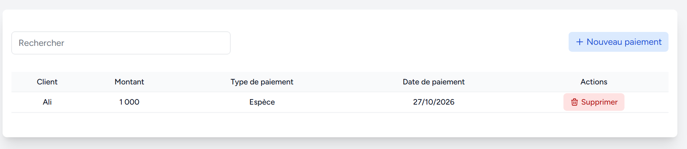
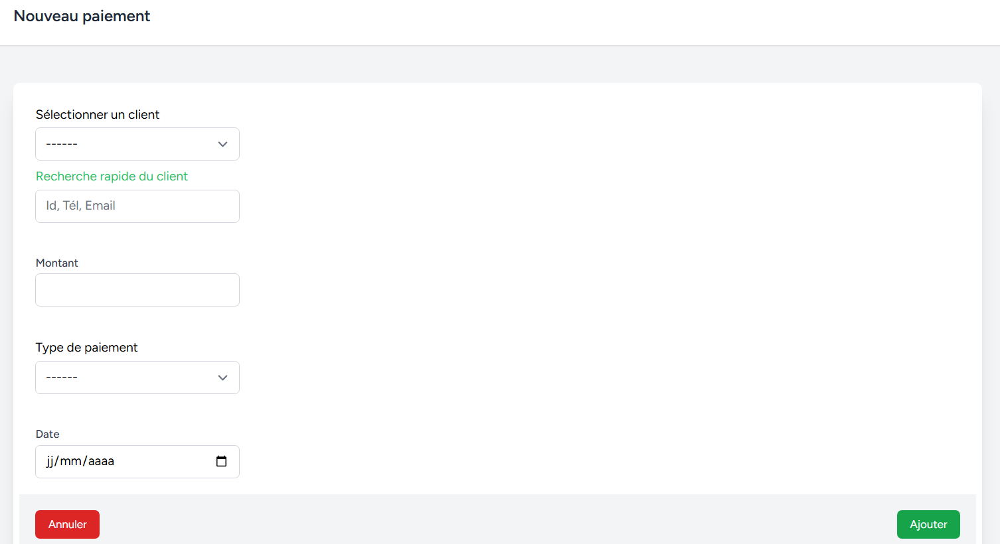

# Trésorerie : Paiements Clients

[⬅ Retour au sommaire](../USER_GUIDE.md)

Ce module vous permet d'enregistrer les règlements (encaissements) effectués par vos clients. Il est principalement utilisé pour solder les ventes à crédit.

Pour y accéder, allez dans **Clients > Liste Paiements**.

---

## 1. Consulter l'historique des paiements

L'écran affiche la liste de tous les règlements reçus :
- Le **Client**.
- Le **Montant** reçu.
- Le **Type de paiement** (Espèces, Bankily, etc.).
- La **Date de paiement**.

*Vous pouvez utiliser la barre de recherche pour retrouver un paiement par nom de client ou par date.*

### ⚠️ Annuler un paiement (Supprimer)
Si vous avez enregistré un paiement par erreur, cliquez sur le bouton rouge **Supprimer**.
**Conséquences de l'annulation :**
- Le montant est retiré de votre caisse.
- La dette du client ré-augmente (sa situation est recalculée).
- Le montant est remis dans la "Méthode Crédit".

---

## 2. Enregistrer un nouveau Paiement Client

Pour encaisser de l'argent, cliquez sur le bouton bleu **Nouveau paiement**.

1. **Sélectionner un client** *(Obligatoire)* : 
   - Seuls les clients ayant une **dette (situation > 0)** apparaissent dans cette liste déroulante. Si un client n'apparaît pas, c'est qu'il vous doit 0.
   - *Astuce : Utilisez la "Recherche rapide" avec l'ID, le Téléphone ou l'Email.*
2. **Montant** *(Obligatoire)* : 
   - L'application affiche la **Situation du client** (le total de ce qu'il vous doit).
   - Saisissez le montant qu'il vous donne. **Attention :** le montant saisi ne peut pas être supérieur à sa dette. Si le client paie plus que sa dette, l'application affichera une erreur.
3. **Type de paiement** *(Obligatoire)* : Choisissez comment il paie (Espèces, Bankily, etc.). *(Note : La méthode "Crédit" n'apparaît pas ici).*
4. **Date** *(Obligatoire)* : La date de réception de l'argent.
5. Cliquez sur **Ajouter**.

*Résultat : L'argent est ajouté à votre caisse, et la dette du client est automatiquement diminuée du montant payé.*