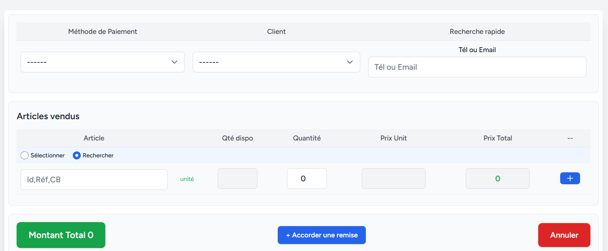
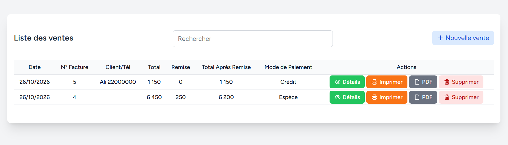
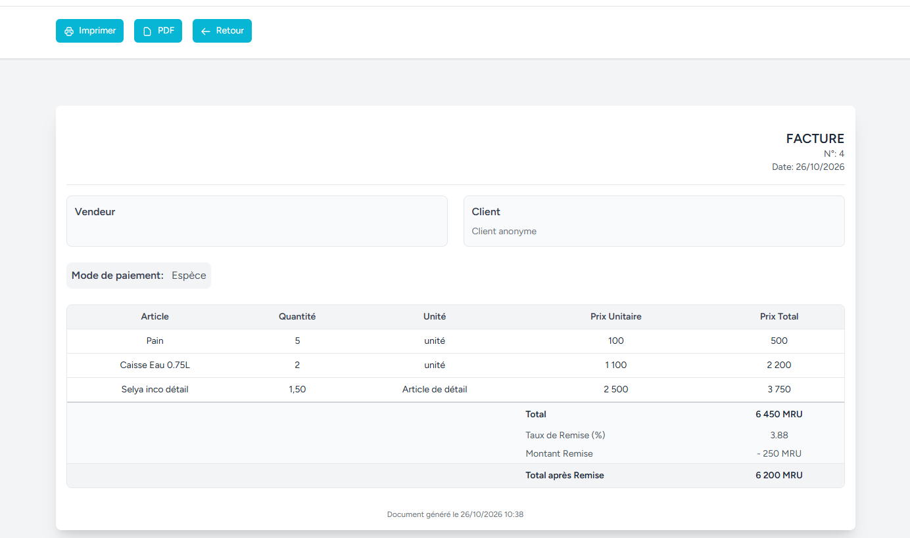

# Enregistrer une Vente (Facturation)

[⬅ Retour au sommaire](../USER_GUIDE.md)

Le menu **Ventes** vous permet d'enregistrer une nouvelle transaction, de gérer vos factures et de suivre vos encaissements. C'est l'écran le plus utilisé au quotidien.

---

## 1. Créer une nouvelle vente

Pour enregistrer une vente, allez dans **Ventes > Nouvelle vente**.

L'écran se divise en 3 grandes parties.

### A. Informations Vendeur (En-tête)
Tout en haut, renseignez les informations de base de la vente :
- **Méthode de Paiement** *(Obligatoire)* : Sélectionnez le mode de règlement (Espèces, Bankily, Crédit, etc.).
- **Client** : Sélectionnez le client dans la liste déroulante. *Note : Le client est **obligatoire** si vous choisissez la méthode de paiement "Crédit" (sinon la vente ne pourra pas être validée).*
- **Recherche rapide (Tél ou Email)** : Une astuce pour gagner du temps ! Tapez le numéro de téléphone ou l'e-mail d'un client. L'application trouvera le client et le sélectionnera automatiquement dans la liste.

### B. Articles vendus (Lignes de vente)
C'est ici que vous ajoutez les produits achetés par le client.

**Ajouter un article :**
Vous avez deux façons de trouver un article :
1. **Sélectionner** : Cochez le bouton radio "Sélectionner", puis choisissez l'article dans la liste déroulante.
2. **Rechercher** : Cochez le bouton radio "Rechercher", puis tapez l'ID, la Référence ou le Code-barres de l'article. *Si le code-barres est scanné, l'article s'ajoute instantanément avec son prix.*

**Remplir la ligne :**
Une fois l'article sélectionné, l'application remplit automatiquement la **Qté dispo**, le **Prix Unit**, et calcule le **Prix Total**.
- **Quantité** *(Obligatoire)* : Saisissez la quantité vendue.
   - Si l'article est à l'unité (objets indivisibles), la quantité doit être un **nombre entier** (ex: 1, 5, 10).
   - Si l'article est en vrac (kilo, litre), vous pouvez mettre une **virgule** (ex: 1.5).
   - La quantité ne peut pas dépasser la **Qté dispo** (sinon une erreur rouge s'affiche).

**Gérer les lignes :**
- Pour ajouter un autre article, cliquez sur le bouton bleu avec le **"+"**.
- Pour retirer une ligne, cliquez sur l'icône **corbeille rouge**.

### C. Remise et Totaux (Validation)
Une fois tous les articles ajoutés, regardez en bas de l'écran.

**Appliquer une remise (Optionnel) :**
1. Cliquez sur le bouton bleu **"+ Accorder une remise"**.
2. Un panneau s'ouvre pour choisir le type de remise :
   - **Taux Remise %** : Tapez un pourcentage (ex: 10 pour 10%).
   - **Montant Remise** : Tapez un montant fixe (ex: 500).
3. Les totaux se recalculent automatiquement.

**Valider la vente :**
Le bouton vert en bas à gauche affiche le **Montant Total** à encaisser.
1. Cliquez sur ce bouton pour valider.
2. L'application va :
   - Enregistrer la vente.
   - Déduire les articles du stock.
   - Mettre à jour la caisse (ou la dette du client si c'est à crédit).
   - Vous rediriger vers la **Facture** générée.

*(Pour annuler et revenir à la liste, cliquez sur le bouton rouge **Annuler**).*

---

## 2. Consulter la liste des Ventes (Factures)

Le menu **Ventes** (ou **Factures**) affiche l'historique de toutes vos transactions.

Chaque ligne représente une facture et affiche :
- La **Date** de la vente.
- Le **N° de Facture**.
- Le **Client** et son numéro de téléphone (ou "Client anonyme").
- Le **Total** initial.
- Le montant de la **Remise** (s'il y en a une).
- Le **Total après Remise** (le montant réel à payer).
- Le **Mode de Paiement**.

**Les Actions disponibles sur chaque ligne :**
- **Détails** (icône œil) : Permet de voir le détail complet de la facture.
- **Imprimer** (icône imprimante) : Ouvre une fenêtre d'impression rapide.
- **PDF** (icône document) : Télécharge la facture au format PDF.
- **Supprimer** (icône corbeille) : Annule la vente et remet les articles en stock.

*Vous pouvez utiliser la barre de recherche en haut à droite pour retrouver une facture par le nom du client, son numéro de téléphone ou le mode de paiement.*

---

## 3. Afficher / Imprimer une Facture

Lorsque vous cliquez sur l'icône d'impression ou de détails, l'application génère un document formaté.

- **En-tête** : Affiche le numéro de facture, la date, les informations du vendeur et du client.
- **Corps** : La liste des articles vendus avec la quantité, l'unité, le prix unitaire et le total par ligne.
- **Pied de page** : Le récapitulatif des totaux (Total, Taux de remise, Montant remise, et Total après remise).

En haut de la page, vous avez 3 boutons :
1. **Imprimer** : Lance l'impression sur l'imprimante connectée.
2. **PDF** : Télécharge le document.
3. **Retour** : Ramène à la liste des factures.

---

## 4. Supprimer une Facture (Annulation de vente)

⚠️ **Attention : La suppression d'une facture est une action lourde et irréversible.**

Lorsque vous cliquez sur la corbeille pour supprimer une facture, l'application ne se contente pas de l'effacer. Elle effectue une **annulation complète** de la transaction :
1. **Remise en stock** : Les quantités des articles vendus sont rajoutées au stock actuel.
2. **Mise à jour de la caisse** : Le montant de la vente est retiré du solde de la méthode de paiement (ex: si c'était en espèces, la caisse diminue).
3. **Mise à jour du client** : Si c'était une vente à crédit, la dette du client est diminuée.
4. **Nettoyage** : Les enregistrements liés (mouvements de stock, opérations de caisse, remises) sont supprimés.

Une fenêtre de confirmation s'affichera pour vous demander si vous êtes sûr de vouloir continuer.